# Diabetes Health Analytics & Prediction Lab: Final Report

- **Course:** AAI-500 Probability and Statistics for AI
- **Team:** Arunava Banerjee (data and EDA); Binish Hamdani (probability and inference);
  Sanjay Varghese Stephen (regression and machine learning)
- **Date:** 19 October 2026
- **Repository:** https://github.com/sstephen-2102/diabetes_health_analytics, commit [FINAL COMMIT HASH]
- **Live application:** https://diabeteshealthanalytics-arunava-binish-sanjay.streamlit.app

---

## Abstract

This project examines how demographic, health, behavioral and socioeconomic indicators relate to a
binary prediabetes-or-diabetes outcome, and how well those indicators predict it. We analyze the CDC
Behavioral Risk Factor Surveillance System (BRFSS) 2015 Diabetes Health Indicators dataset (UCI dataset
891): 253,680 survey responses with 21 features, of which 13.93% are in the outcome category. The
analysis moves from descriptive statistics, probability and Bayes' theorem, through Wilson and t
confidence intervals and chi-square and Welch tests with effect sizes, to logistic regression with a
BMI × Age interaction and three machine-learning classifiers evaluated for class imbalance, threshold
choice and calibration. Self-rated general health shows the strongest unadjusted association with the
outcome (Spearman ρ = 0.288), and high blood pressure keeps an adjusted odds ratio of 2.13 (95% CI
2.07–2.20) after accounting for all other features. On held-out data, gradient boosting reaches ROC AUC
0.819 and PR AUC 0.441, slightly ahead of logistic regression (0.810 and 0.414), but at the default 0.5
threshold every model identifies only 15–18% of outcome cases. Because the data are unweighted,
cross-sectional and self-reported, all results describe associations in this sample, not population
prevalence or causal effects. All results can be explored in an interactive Streamlit application.

---

## 1. Introduction and research objective

Prediabetes and diabetes are common chronic conditions, and the indicators that accompany them, such
as blood pressure, cholesterol, body mass index (BMI), physical activity and self-rated health, are
inexpensive to collect in population surveys. The BRFSS is one such survey, and earlier work has used
it to build machine-learning models for diabetes risk (Xie et al., 2019). This project takes a
statistics-first view of the same kind of data: before asking how well a model predicts the outcome,
it asks how the outcome is distributed, how its probability changes under different conditions, which
associations are statistically detectable and how large they are.

The primary objective is to investigate relationships between demographic, health, behavioral and
socioeconomic indicators and the `Diabetes_binary` outcome, and to evaluate whether those indicators
can predict it using interpretable statistical and machine-learning methods. The project is an
educational research exercise, not a clinical diagnostic tool. Thirteen research questions (Table 1)
and eleven hypotheses (Table 2) structure the work.

The report follows the analysis pipeline. Sections 2–4 describe the dataset, the target definition and
data quality, including how repeated rows are handled. Sections 5–9 cover descriptive statistics,
probability, confidence intervals, hypothesis tests and effect sizes. Sections 10–11 fit logistic
regression models, and sections 12–16 evaluate machine-learning classifiers, class imbalance, decision
thresholds, calibration and feature importance. Section 17 sets out the limitations and section 18
answers each research question.

**Table 1.** Research questions and where they are answered.

| RQ | Question | Section |
|---|---|---|
| RQ1 | What characteristics describe the analytical sample? | 5 |
| RQ2 | How is `Diabetes_binary` distributed? | 5 |
| RQ3 | How does the probability of category 1 change under selected conditions? | 6 |
| RQ4 | Can Bayes' theorem be demonstrated and verified from the observed data? | 6 |
| RQ5 | What confidence intervals describe selected proportions, means and differences? | 7 |
| RQ6 | Which variables show statistically detectable associations with the outcome? | 8 |
| RQ7 | How large are the effects, and how should they be read alongside p-values? | 9 |
| RQ8 | Which variables remain associated after simultaneous adjustment? | 10 |
| RQ9 | Does the BMI–outcome relationship vary by age? | 11 |
| RQ10 | How do logistic regression, random forest and gradient boosting compare? | 12 |
| RQ11 | How does class imbalance affect model behavior? | 13 |
| RQ12 | How do thresholds affect precision, recall, specificity and F1; are probabilities calibrated? | 14, 15 |
| RQ13 | How does exact-duplicate handling affect train/test integrity and evaluation? | 4 |

**Table 2.** Hypotheses. H1–H7 are tested in section 8, H8 in section 10, H9 in section 11, H10 in
section 13 and H11 in section 4.

| ID | Alternative hypothesis |
|---|---|
| H1 | The `Diabetes_binary` outcome is associated with HighBP. |
| H2 | The `Diabetes_binary` outcome is associated with HighChol. |
| H3 | Mean BMI differs between target groups. |
| H4 | The `Diabetes_binary` outcome is associated with physical activity. |
| H5 | The `Diabetes_binary` outcome is associated with smoking. |
| H6 | The target outcome differs across age categories. |
| H7 | The target outcome differs across income categories. |
| H8 | Selected predictors remain associated with the target after adjustment. |
| H9 | The BMI–target association varies with age. |
| H10 | Class-imbalance strategy changes predictive behavior. |
| H11 | Exact-duplicate handling changes some model evaluation results. |

---

## 2. Dataset, source and verification

The data originate in the BRFSS 2015 telephone survey (Centers for Disease Control and Prevention
[CDC], 2016a). A cleaned subset was published on Kaggle (Teboul, 2021) and is distributed by the UCI
Machine Learning Repository as dataset 891 (*CDC Diabetes Health Indicators*, 2017); the application
and analysis pipeline download the UCI copy. Variable definitions follow the BRFSS 2015 codebook (CDC,
2016b).

Before any analysis, the data pass a verification gate. The file has 253,680 rows and 22 columns (21
features plus the target) with no missing cells, and every reference check passes: row and column
counts, missing cells, duplicate rows and target counts all match the expected reference values for
the dataset. The exact file behind the reported results is identified by its SHA-256 fingerprint
(Appendix A).

The 21 features fall into four types (Table 3): 14 binary indicators; four ordinal scales (general
health from 1 = excellent to 5 = poor, 13 five-year age bands, six education levels and eight income
levels); two day counts (poor mental-health and physical-health days in the past 30); and BMI, recorded
as a whole number between 12 and 98.

**Table 3.** Variable summary (`full_clean_v1`, n = 253,680). Full coding is in `docs/DATA_DICTIONARY.md`.

| Group | Variables | Coding |
|---|---|---|
| Target | Diabetes_binary | 0 = neither prediabetes nor diabetes; 1 = prediabetes or diabetes |
| Cardiometabolic | HighBP, HighChol, CholCheck, Stroke, HeartDiseaseorAttack | 0 = no, 1 = yes |
| Behavior | Smoker, PhysActivity, Fruits, Veggies, HvyAlcoholConsump | 0 = no, 1 = yes |
| Access to care | AnyHealthcare, NoDocbcCost | 0 = no, 1 = yes |
| Health status | GenHlth (1 = excellent … 5 = poor), MentHlth, PhysHlth (days of 30), DiffWalk (0/1) | ordinal, count, binary |
| Body size | BMI | recorded value, 12–98 |
| Demographics | Sex (0 = female, 1 = male), Age (13 five-year bands), Education (1–6), Income (1–8) | binary, ordinal |

---

## 3. Target definition and terminology

The target, `Diabetes_binary`, has two categories. Category 0 means neither prediabetes nor diabetes;
category 1 means prediabetes **or** diabetes. Combining the two conditions is a project-defined outcome
inherited from the published dataset, so the positive class mixes respondents at different stages.

Category 1 reflects self-reported survey answers, not a clinical diagnosis, and the original
preprocessing that turned the BRFSS questions into a binary target was not independently audited. To
keep this distinction visible, the report and the application refer to "category 1", the
"prediabetes-or-diabetes outcome" or the "`Diabetes_binary` outcome", and describe relationships as
associations rather than causes.

---

## 4. Data quality and duplicate analysis

The dataset contains no missing values, but it does contain repeated rows. 24,206 rows (9.54%) exactly
repeat an earlier row, 35,575 rows belong to a repeated answer pattern, and there are 229,474 distinct
profiles. Because the survey questions are coarse (mostly yes/no or short scales) and there is no
respondent identifier, identical rows cannot be confirmed as the same person answering twice, and they
are not treated as errors.

Removing repeats changes the sample. Of the 24,206 removed rows, 23,957 (99.0%) are in category 0 and
only 249 in category 1, so the category 1 share rises from 13.93% in the full data (`full_clean_v1`) to
15.29% in the deduplicated data (`unique_profile_v1`), an increase of 1.36 percentage points. The
within-group share rises most in older age bands (65–69: +1.91 points) and in the highest education
and income groups (college graduates +1.90; income USD 75,000 or more +1.87), where the repeated
category 0 rows were most common. BMI has 9,847 values (3.88%) outside
the interquartile-range fences of 13.5 and 41.5 (27 below and 9,820 above); these are retained as
recorded values because a statistical flag does not establish an error.

The project therefore uses two dataset variants. `full_clean_v1` keeps every row and is used for
descriptive statistics, inference and regression, which describe the sample as published.
`unique_profile_v1` keeps one row per distinct profile and is used for machine learning, with a
train/test split grouped by feature vector so that no profile appears on both sides. The leakage check
passes: zero profiles are shared between the 183,579 training rows and 45,895 test rows (Kaufman et al.,
2012).

To test whether this choice matters (H11), the three baseline classifiers were retrained under four
scenarios: each variant with a grouped or a random split (Tables 4 and 5). H11 is supported, but mainly
through test-set composition rather than leakage. Keeping repeats (full versus unique data, both
grouped) raises ROC AUC by 0.012–0.014 and lowers the Brier score by about 0.009, yet lowers PR AUC by
0.007–0.009, because the extra rows are mostly easy negatives that are simple to rank. A random split did
not inflate the metrics here: ROC AUC changed by between −0.011 and +0.001 compared with the grouped
split. The grouped split is still the correct design, because it is the only one that measures
performance on profiles the model has never seen.

**Table 4.** Test-set composition by scenario (seed 42, 80/20 stratified split).

| Variant | Split | Train | Test | Test prevalence | Test rows seen in training |
|---|---|---|---|---|---|
| `unique_profile_v1` (primary) | grouped | 183,579 | 45,895 | 15.3% | 0 |
| `unique_profile_v1` | random | 183,579 | 45,895 | 15.3% | 502 (1.1%) |
| `full_clean_v1` | grouped | 202,943 | 50,737 | 13.9% | 0 |
| `full_clean_v1` | random | 202,944 | 50,736 | 13.9% | 6,836 (13.5%) |

**Table 5.** ROC AUC / PR AUC / Brier score on all test rows, by duplicate-handling scenario.

| Model | Unique, grouped (primary) | Unique, random | Full, grouped | Full, random |
|---|---|---|---|---|
| Logistic regression | 0.810 / 0.414 / 0.107 | 0.810 / 0.414 / 0.107 | 0.822 / 0.406 / 0.099 | 0.819 / 0.394 / 0.100 |
| Random forest | 0.789 / 0.396 / 0.110 | 0.778 / 0.358 / 0.114 | 0.804 / 0.389 / 0.101 | 0.796 / 0.369 / 0.104 |
| Gradient boosting | 0.819 / 0.441 / 0.105 | 0.819 / 0.446 / 0.105 | 0.831 / 0.434 / 0.096 | 0.826 / 0.421 / 0.098 |

---

## 5. Descriptive statistics

Of the 253,680 respondents, 35,346 (13.93%) are in category 1 and 218,334 (86.07%) are in category 0
(Figure 1), so the classes are imbalanced by roughly six to one. Mean BMI is 28.38 (SD 6.61; median 27,
IQR 24–31). The two day counts are heavily right-skewed: mental-health days have mean 3.18 and
physical-health days mean 4.24, but the median of both is 0, meaning most respondents report no poor
days at all.

The outcome groups differ on almost every characteristic (Table 6). Category 1 respondents report more
poor physical-health days (mean 7.95 versus 3.64), and 16.2% of them report all 30 days compared with
6.3% of category 0; mental-health days differ less (4.46 versus 2.98). BMI is higher in category 1
(Figure 2; tested formally in section 8).

The category 1 share follows clear unadjusted gradients. It rises from 2.52% among respondents in
excellent general health to 37.89% among those in poor health (Figure 3), and from 1.37% at ages 18–24
to 21.85% at 70–74 before easing to 18.48% at 80 and over (Figure 4). It falls with income, from 26.19%
at USD 10,000–<15,000 to 7.96% at USD 75,000 or more, and with education, from 29.26% among those with
grades 1–8 to 9.69% among college graduates. Among binary indicators, the largest gaps appear for heart
disease or heart attack (32.97% versus 11.95%, a 21.0-point difference), difficulty walking (30.75% versus
10.53%), stroke (31.75% versus 13.18%) and high blood pressure (24.45% versus 6.04%). Physical activity
(11.61% versus 21.14%) and heavy alcohol use (5.84% versus 14.42%) run the other way.

Spearman rank correlations (Spearman, 1904) summarize these monotone relationships (Figure 5). General
health has the strongest correlation with the outcome (ρ = 0.288), followed by BMI (0.226), age (0.178)
and physical-health days (0.157), while income (−0.163) and education (−0.120) are negative. Among the
features themselves, the strongest pairs are general health with physical-health days (0.452) and
education with income (0.452), a reminder that several indicators carry overlapping information. The
matrix is descriptive and is not a ranking of importance.

**Table 6.** Category 1 share by selected characteristics (`full_clean_v1`, n = 253,680; unadjusted).

| Characteristic | Group | n | Category 1 share |
|---|---|---|---|
| High blood pressure | No / Yes | 144,851 / 108,829 | 6.04% / 24.45% |
| High cholesterol | No / Yes | 146,089 / 107,591 | 7.98% / 22.01% |
| Physical activity | No / Yes | 61,760 / 191,920 | 21.14% / 11.61% |
| Sex | Female / Male | 141,974 / 111,706 | 12.97% / 15.16% |
| General health | Excellent / Good / Poor | 45,299 / 75,646 / 12,081 | 2.52% / 17.79% / 37.89% |
| Age | 18–24 / 70–74 / 80+ | 5,700 / 23,533 / 17,363 | 1.37% / 21.85% / 18.48% |
| Income | USD 10,000–<15,000 / USD 75,000+ | 11,783 / 90,385 | 26.19% / 7.96% |

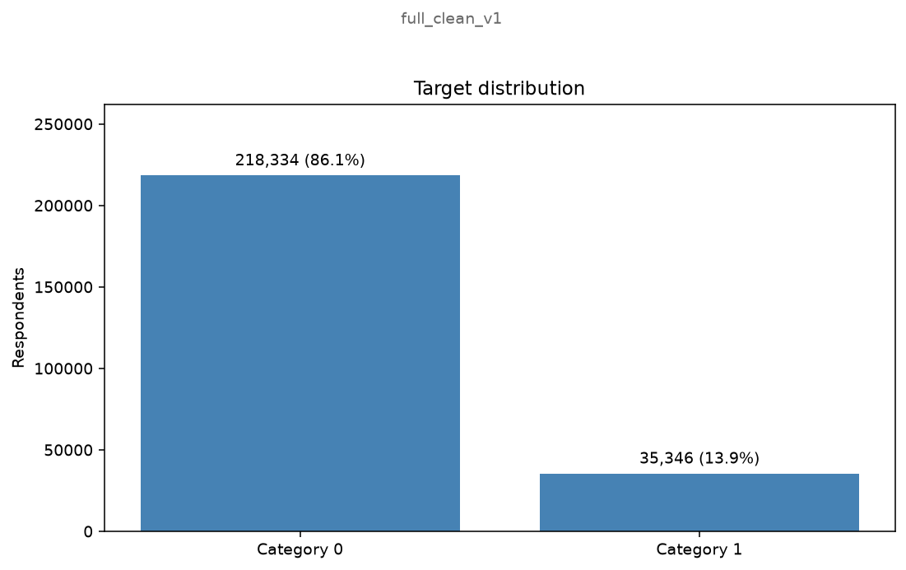

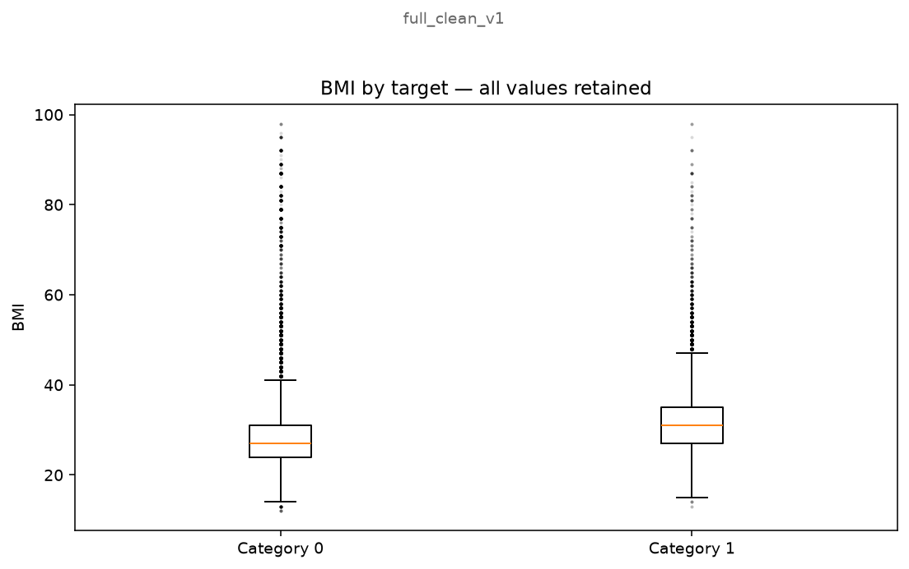

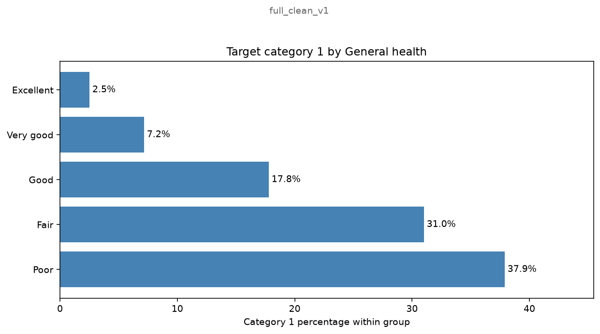

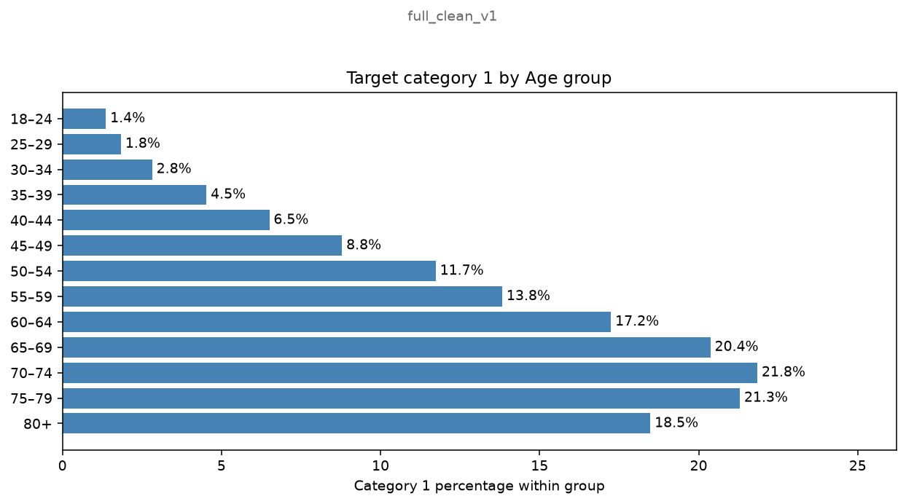

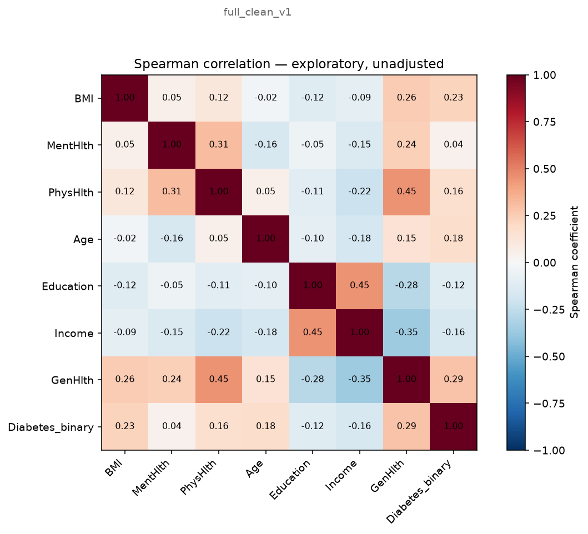

---

## 6. Probability and Bayes analysis

The marginal probability of category 1 is P(category 1) = 0.1393 (95% Wilson CI 0.1380–0.1407).
Conditioning on selected characteristics shows how this probability moves (Table 7). Among respondents
with high blood pressure it is 0.2445, about 1.75 times the overall value; with both high blood pressure
and high cholesterol it reaches 0.2971; and among physically active respondents with neither condition
it falls to 0.0351. Income shows a similar spread, from 0.2429 below USD 10,000 to 0.0796 at USD 75,000 or
more.

The table also shows how joint and conditional probabilities relate. The joint probability of high blood
pressure and category 1 is 0.1049 and the probability of high blood pressure is 0.4290, so the
conditional probability is P(category 1 | HighBP = 1) = 0.1049 / 0.4290 = 0.2445, the same value obtained
by counting directly.

Bayes' theorem was verified in the same way (Table 8). For seven yes/no features, the likelihood
P(feature | category 1) multiplied by the prior P(category 1) and divided by the evidence P(feature)
equals the directly counted P(category 1 | feature) in both dataset variants, with an absolute
difference of zero to floating-point precision. The ratio of each conditional probability to the prior
(the lift) is largest for heart disease or heart attack (2.37), stroke (2.28), difficulty walking (2.21)
and high blood pressure (1.75), and below 1 for physical activity (0.83). These are observed shares in
this sample, not model predictions or individual risks.

**Table 7.** Marginal, joint and conditional probabilities of category 1 (`full_clean_v1`,
n = 253,680; Wilson 95% CI).

| Conditions | P(conditions) | P(conditions and category 1) | Respondents meeting conditions | P(category 1 \| conditions) | 95% CI |
|---|---|---|---|---|---|
| None (all respondents) | 1.0000 | 0.1393 | 253,680 | 0.1393 | 0.1380–0.1407 |
| HighBP = 1 | 0.4290 | 0.1049 | 108,829 | 0.2445 | 0.2419–0.2470 |
| HighChol = 1 | 0.4241 | 0.0934 | 107,591 | 0.2201 | 0.2177–0.2226 |
| PhysActivity = 1 | 0.7565 | 0.0879 | 191,920 | 0.1161 | 0.1147–0.1176 |
| HighBP = 1 and HighChol = 1 | 0.2549 | 0.0757 | 64,660 | 0.2971 | 0.2936–0.3007 |
| HighBP = 0, HighChol = 0, PhysActivity = 1 | 0.3268 | 0.0115 | 82,892 | 0.0351 | 0.0339–0.0364 |
| Sex = male | 0.4403 | 0.0668 | 111,706 | 0.1516 | 0.1495–0.1537 |
| Age 70–74 | 0.0928 | 0.0203 | 23,533 | 0.2185 | 0.2132–0.2238 |
| Income under USD 10,000 | 0.0387 | 0.0094 | 9,811 | 0.2429 | 0.2345–0.2515 |
| Income USD 75,000+ | 0.3563 | 0.0284 | 90,385 | 0.0796 | 0.0779–0.0814 |

**Table 8.** Bayes' theorem check, feature value 1 (`full_clean_v1`, n = 253,680; prior P(category 1) = 0.1393).

| Feature | Likelihood P(x \| cat. 1) | Evidence P(x) | Bayes result | Direct count | Lift over prior |
|---|---|---|---|---|---|
| HighBP | 0.7527 | 0.4290 | 0.2445 | 0.2445 | 1.75 |
| HighChol | 0.6701 | 0.4241 | 0.2201 | 0.2201 | 1.58 |
| PhysActivity | 0.6305 | 0.7565 | 0.1161 | 0.1161 | 0.83 |
| Smoker | 0.5182 | 0.4432 | 0.1629 | 0.1629 | 1.17 |
| Stroke | 0.0925 | 0.0406 | 0.3175 | 0.3175 | 2.28 |
| HeartDiseaseorAttack | 0.2229 | 0.0942 | 0.3297 | 0.3297 | 2.37 |
| DiffWalk | 0.3712 | 0.1682 | 0.3075 | 0.3075 | 2.21 |

The same checks for `unique_profile_v1` give a prior of 0.1529 and, for example,
P(category 1 | HighBP = 1) = 0.2533.

---

## 7. Confidence intervals

Proportions are estimated with Wilson score intervals (Wilson, 1927), means with t intervals on n − 1
degrees of freedom, and differences in means with Welch intervals using Satterthwaite degrees of
freedom (Welch, 1947); all are 95% intervals (Table 9). With group sizes in the tens of thousands, the
intervals are narrow: the overall category 1 share of 13.93% is known to within about ±0.13 percentage
points. That precision reflects sampling variation only; it does not account for the survey design or
for measurement error in self-reported answers.

The intervals confirm the gaps seen in section 5. Mean BMI is 31.94 (31.87–32.02) in category 1 and
27.81 (27.78–27.83) in category 0, a difference of 4.14 BMI points (4.06–4.22). Category 1 respondents
report 4.31 more poor physical-health days (4.19–4.44) and 1.48 more poor mental-health days
(1.39–1.58). None of the intervals for differences comes close to zero. In the deduplicated data the BMI
difference is slightly smaller, 3.87 (3.79–3.95), as is the physical-health-days difference, 3.93
(3.80–4.05), but the conclusions do not change.

**Table 9.** 95% confidence intervals (`full_clean_v1`, n = 253,680).

| Estimate | Group | n | Estimate | 95% CI | Method |
|---|---|---|---|---|---|
| Category 1 share | All respondents | 253,680 | 13.93% | 13.80–14.07% | Wilson |
| Category 1 share | HighBP no / yes | 144,851 / 108,829 | 6.04% / 24.45% | 5.91–6.16% / 24.19–24.70% | Wilson |
| Category 1 share | HighChol no / yes | 146,089 / 107,591 | 7.98% / 22.01% | 7.84–8.12% / 21.77–22.26% | Wilson |
| Category 1 share | PhysActivity no / yes | 61,760 / 191,920 | 21.14% / 11.61% | 20.82–21.47% / 11.47–11.76% | Wilson |
| Category 1 share | Smoker no / yes | 141,257 / 112,423 | 12.06% / 16.29% | 11.89–12.23% / 16.08–16.51% | Wilson |
| Category 1 share | GenHlth excellent / poor | 45,299 / 12,081 | 2.52% / 37.89% | 2.38–2.66% / 37.03–38.76% | Wilson |
| Mean BMI | Category 1 / 0 | 35,346 / 218,334 | 31.94 / 27.81 | 31.87–32.02 / 27.78–27.83 | t |
| BMI difference | 1 minus 0 | 253,680 | 4.14 | 4.06–4.22 | Welch |
| Mean PhysHlth days | Category 1 / 0 | 35,346 / 218,334 | 7.95 / 3.64 | 7.84–8.07 / 3.61–3.67 | t |
| PhysHlth difference | 1 minus 0 | 253,680 | 4.31 | 4.19–4.44 | Welch |
| Mean MentHlth days | Category 1 / 0 | 35,346 / 218,334 | 4.46 / 2.98 | 4.37–4.56 / 2.95–3.01 | t |
| MentHlth difference | 1 minus 0 | 253,680 | 1.48 | 1.39–1.58 | Welch |

---

## 8. Hypothesis testing

Hypotheses H1, H2 and H4–H7 concern categorical features and are tested with chi-square tests of
independence without continuity correction (Pearson, 1900). H3 compares mean BMI between the outcome
groups with a Welch two-sample t-test (Welch, 1947), which does not assume equal variances.

All seven null hypotheses are rejected at p < 0.001, in both dataset variants (Table 10). With more than
229,000 observations the p-values are so small that they underflow to zero in floating-point arithmetic,
so they are reported as p < 0.001; at this sample size even trivial differences are detectable, and the
effect sizes in section 9 are the better basis for comparison.

The assumptions behind the tests hold. Every expected cell count in the chi-square tables is at least
5. BMI is strongly right-skewed in both groups (skewness 1.53 in category 1 and 2.33 in category 0), but
with groups of this size the sampling distribution of the mean is close to normal, so the Welch test of
means remains valid; a difference in means can still hide differences in the shape of the distributions.

No multiplicity adjustment is applied, by team decision. Every p-value is below the Bonferroni threshold
of 0.05 / 7 = 0.0071, so even the strictest common correction would not change any decision. The project
specification also called for ANOVA and post-hoc comparisons; these were not implemented, because H1–H7
need only chi-square and Welch tests and the team scoped the remaining methods out. This is a deliberate
deviation from the specification.

**Table 10.** Hypothesis tests H1–H7 (`full_clean_v1`, n = 253,680).

| Hypothesis | Feature | Test | Statistic | df | p | Effect size | Decision |
|---|---|---|---|---|---|---|---|
| H1 | HighBP | Chi-square | χ² = 17,563.98 | 1 | < 0.001 | V = 0.263 | Reject H0 |
| H2 | HighChol | Chi-square | χ² = 10,175.25 | 1 | < 0.001 | V = 0.200 | Reject H0 |
| H3 | BMI | Welch t | t = 99.92 | 44,093 | < 0.001 | d = 0.641 | Reject H0 |
| H4 | PhysActivity | Chi-square | χ² = 3,540.21 | 1 | < 0.001 | V = 0.118 | Reject H0 |
| H5 | Smoker | Chi-square | χ² = 937.41 | 1 | < 0.001 | V = 0.061 | Reject H0 |
| H6 | Age | Chi-square | χ² = 8,795.05 | 12 | < 0.001 | V = 0.186 | Reject H0 |
| H7 | Income | Chi-square | χ² = 7,003.72 | 7 | < 0.001 | V = 0.166 | Reject H0 |

No multiplicity adjustment is applied; all p-values are below 0.0071 (Bonferroni, 7 tests).

---

## 9. Effect sizes and multiple comparisons

Effect sizes measure how strong each association is, independently of sample size. The chi-square tests
use Cramér's V (Cramér, 1946), the BMI comparison uses Cohen's d with a pooled standard deviation (Cohen,
1988), and two-category features also get an odds ratio with a 95% Woolf interval. By Cohen's (1988)
conventions, V of 0.1, 0.3 and 0.5 (for df = 1) and d of 0.2, 0.5 and 0.8 mark small, medium and large
effects. These are rules of thumb, not clinical thresholds.

On this scale the hypotheses separate clearly (Table 11). BMI shows a medium-to-large standardized
difference (d = 0.64). High blood pressure (V = 0.26) and high cholesterol (V = 0.20) are small to
medium, physical activity is small (V = 0.12), and smoking is negligible (V = 0.06) despite its
p < 0.001, a clear case of statistical significance without practical importance. The unadjusted odds
ratios tell the same story: 5.04 (4.91–5.17) for high blood pressure, 3.25 (3.18–3.33) for high
cholesterol, 1.42 (1.39–1.45) for smoking and 0.49 (0.48–0.50) for physical activity. These unadjusted
odds ratios shrink once other features are accounted for; high blood pressure, for example, falls from
5.04 to 2.13 in section 10.

Every effect keeps its direction in the deduplicated data. Effects shrink most for smoking (V from
0.061 to 0.046), income (0.166 to 0.142) and physical activity (0.118 to 0.100), consistent with the
repeated rows being concentrated in particular answer patterns. Multiple comparisons are handled as
described in section 8.

**Table 11.** Effect sizes by dataset variant (`full_clean_v1`, n = 253,680; `unique_profile_v1`, n = 229,474).

| Hypothesis | Feature | Measure | Full | Unique | Unadjusted OR, full (95% CI) |
|---|---|---|---|---|---|
| H1 | HighBP | Cramér's V | 0.263 | 0.254 | 5.04 (4.91–5.17) |
| H2 | HighChol | Cramér's V | 0.200 | 0.195 | 3.25 (3.18–3.33) |
| H3 | BMI | Cohen's d | 0.641 | 0.582 | — |
| H4 | PhysActivity | Cramér's V | 0.118 | 0.100 | 0.49 (0.48–0.50) |
| H5 | Smoker | Cramér's V | 0.061 | 0.046 | 1.42 (1.39–1.45) |
| H6 | Age | Cramér's V | 0.186 | 0.189 | — |
| H7 | Income | Cramér's V | 0.166 | 0.142 | — |

---

## 10. Logistic regression

To see which associations survive simultaneous adjustment (H8), a logistic regression with all 21
features was fitted to `full_clean_v1` (n = 253,680) using statsmodels (Seabold & Perktold, 2010). BMI
and age were centered at their means (28.38 and age code 8.03) so that the intercept and the interaction
in section 11 are interpretable, and the ordinal codes for general health, age, education and income
were entered as numeric scores. The model converged, with McFadden pseudo-R² = 0.208 (McFadden, 1974).

H8 is supported: most features remain associated with the outcome after adjustment (Table 12, Figure
6). Holding all other features fixed, the odds of category 1 are 2.13 times higher (2.07–2.20) with high
blood pressure and 1.78 times higher (1.74–1.83) with high cholesterol, and they rise by a factor of 1.71
(1.68–1.74) for each step worse in general health, 1.13 (1.13–1.14) per five-year age band and 1.063
(1.061–1.065) per BMI point, which is about 1.36 for a five-point difference (Hosmer et al., 2013). Two
features are not distinguishable from no association: smoking (OR 0.99, 0.96–1.02) and being unable to
see a doctor because of cost (OR 1.02, 0.97–1.07). Smoking's unadjusted association (OR 1.42) therefore
disappears once the other features are included.

Two coefficients need careful reading. Having had a cholesterol check has the largest odds ratio (3.47),
but this probably reflects reverse direction: people who already know they have the condition are
checked more often. Heavy alcohol use has an odds ratio of 0.46, which is more plausibly explained by
confounding or reporting bias than by any benefit, so it should not be described as protective.

**Table 12.** Adjusted odds ratios (`full_clean_v1`, n = 253,680; 95% CI; all other features held fixed).

| Feature | OR | 95% CI | Unit |
|---|---|---|---|
| CholCheck | 3.47 | 3.03–3.97 | had a check vs not |
| HighBP | 2.13 | 2.07–2.20 | yes vs no |
| HighChol | 1.78 | 1.74–1.83 | yes vs no |
| GenHlth | 1.71 | 1.68–1.74 | per step worse (1–5) |
| Sex | 1.29 | 1.26–1.33 | male vs female |
| HeartDiseaseorAttack | 1.25 | 1.20–1.29 | yes vs no |
| Stroke | 1.14 | 1.09–1.20 | yes vs no |
| Age | 1.13 | 1.13–1.14 | per 5-year band |
| DiffWalk | 1.13 | 1.09–1.17 | yes vs no |
| BMI | 1.063 | 1.061–1.065 | per BMI point |
| Income | 0.95 | 0.94–0.96 | per income category |
| PhysActivity | 0.95 | 0.92–0.98 | yes vs no |
| HvyAlcoholConsump | 0.46 | 0.43–0.50 | yes vs no |
| Smoker | 0.99 | 0.96–1.02 | yes vs no (CI includes 1) |
| NoDocbcCost | 1.02 | 0.97–1.07 | yes vs no (CI includes 1) |

The remaining six features (AnyHealthcare, Education, Fruits, MentHlth, PhysHlth and Veggies) have
odds ratios between 0.95 and 1.09; all 21 are in `outputs/tables/full_clean_v1_regression_baseline_odds_ratios.csv`.

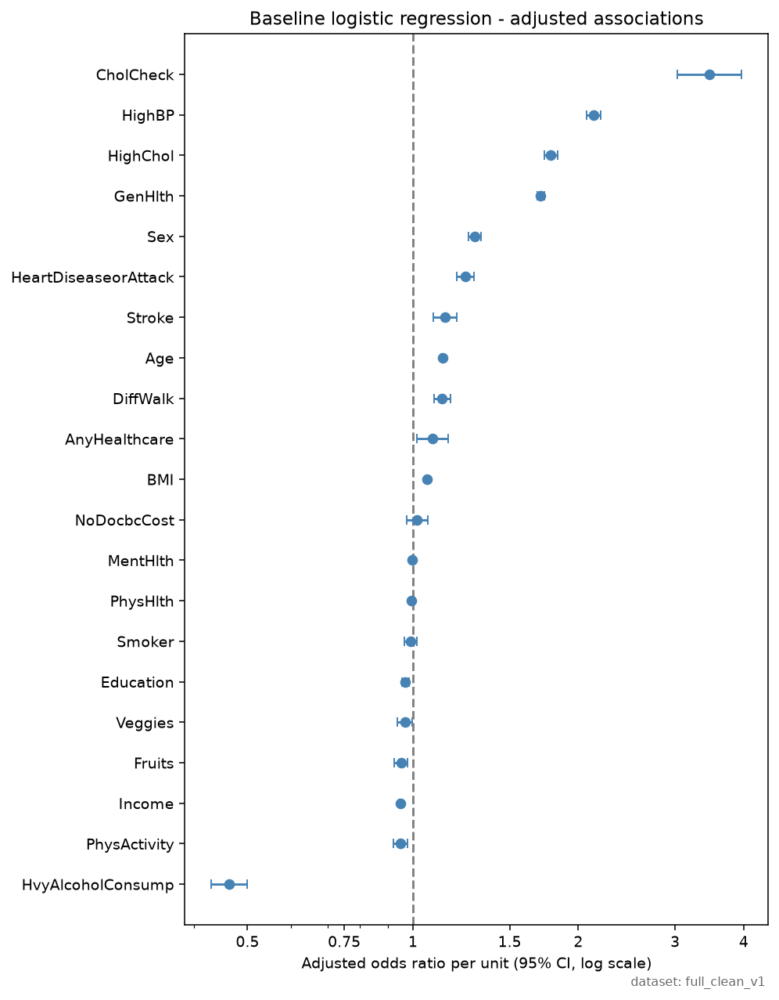

---

## 11. BMI × Age interaction

H9 asks whether the BMI association depends on age. Adding a BMI × Age product term to the baseline
model gives an interaction odds ratio of 1.0050 (95% CI 1.0043–1.0056), so H9 is supported on the odds
scale. The interaction improves the fit (Table 13): the likelihood-ratio test gives χ² = 253.4 on 1 df,
p ≈ 5 × 10⁻⁵⁷ (Wilks, 1938), and both AIC (Akaike, 1974) and BIC (Schwarz, 1978) fall, by 251.4 and 240.9.
The gain in explained variation is small, however: pseudo-R² rises only from 0.2083 to 0.2095. The
interaction is real but modest.

Figure 7 shows what it means in practice. The odds ratio per BMI point grows steadily with age, from
1.026 at ages 18–24 to 1.047 at 40–44, 1.068 at 60–64 and 1.089 at 80 and over. For a five-point BMI
difference, that is roughly 1.14, 1.26, 1.39 and 1.53. Three cautions apply: the interaction is defined on
the log-odds scale, so it need not hold on the probability scale; age is recorded in bands and treated as
linear; and cross-sectional data say nothing about how BMI changes over an individual's lifetime.

**Table 13.** Model comparison (`full_clean_v1`, n = 253,680).

| Model | Log-likelihood | AIC | BIC | Pseudo-R² |
|---|---|---|---|---|
| Baseline | −81,091.8 | 162,227.6 | 162,457.4 | 0.2083 |
| Baseline + BMI × Age | −80,965.1 | 161,976.2 | 162,216.5 | 0.2095 |

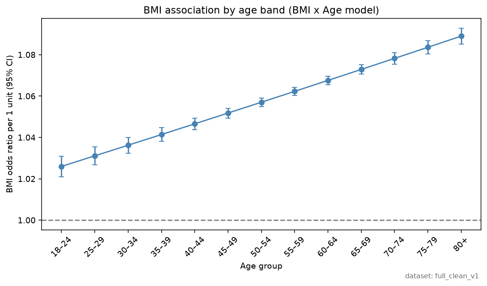

---

## 12. Machine-learning models

Three classifiers were compared using scikit-learn (Pedregosa et al., 2011) with default settings:
logistic regression, a random forest with 100 trees (Breiman, 2001) and gradient boosting with 100 trees
of depth 3 (Friedman, 2001). Each was trained on 183,579 rows of `unique_profile_v1` and evaluated once on
45,895 held-out rows, using an 80/20 split stratified by outcome and grouped by profile (seed 42).

Accuracy is uninformative here: every model scores about 0.85, close to the 0.847 that would be achieved
by always predicting category 0. The evaluation therefore focuses on ranking and probability measures
(Steyerberg et al., 2010): ROC AUC (Fawcett, 2006), PR AUC, which is more informative under class
imbalance (Saito & Rehmsmeier, 2015), and the Brier score (Table 14, Figures 8 and 9). Gradient boosting
leads slightly, with ROC AUC 0.819, PR AUC 0.441 and Brier 0.105. Logistic regression is close behind
(0.810, 0.414 and 0.107), and the random forest is weakest (0.789, 0.396 and 0.110). All three PR AUC
values are 2.6–2.9 times the no-skill baseline of 0.153, the test-set prevalence.

At the default threshold of 0.5, however, recall is only 0.15–0.18: every model misses more than 80% of
category 1 respondents, which motivates the imbalance and threshold analyses in sections 13 and 14. The
comparison rests on a single split without confidence intervals, so differences of about 0.01 in AUC
should not be over-interpreted.

**Table 14.** Test-set performance at threshold 0.5 (`unique_profile_v1`, test n = 45,895).

| Model | Accuracy | ROC AUC | PR AUC | Brier | Recall | Precision | Specificity | F1 |
|---|---|---|---|---|---|---|---|---|
| Logistic regression | 0.852 | 0.810 | 0.414 | 0.107 | 0.153 | 0.554 | 0.978 | 0.239 |
| Random forest | 0.850 | 0.789 | 0.396 | 0.110 | 0.184 | 0.524 | 0.970 | 0.272 |
| Gradient boosting | 0.855 | 0.819 | 0.441 | 0.105 | 0.164 | 0.588 | 0.979 | 0.256 |

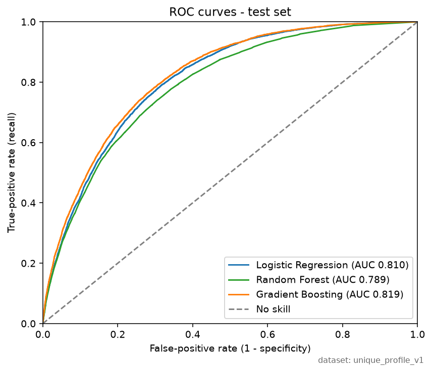

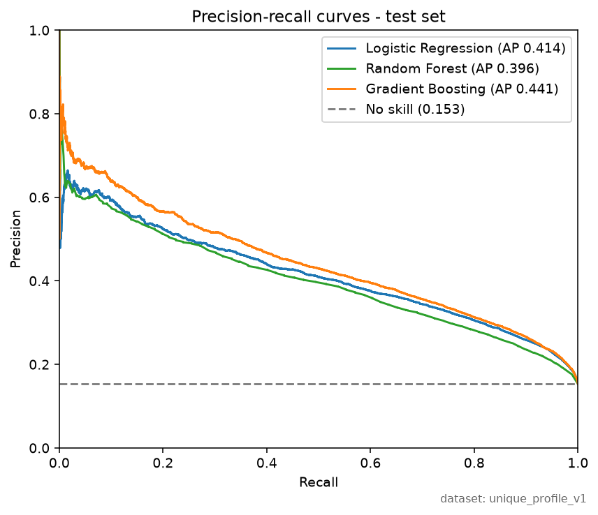

---

## 13. Class-imbalance experiments

The training set has 155,501 category 0 rows and 28,078 category 1 rows. Two common remedies for this
imbalance (He & Garcia, 2009) were compared with the original data using logistic regression: class
weighting, which gives each class equal total weight, and random undersampling of category 0 to 28,078
rows. All three versions were scored on the same untouched test set (Table 15).

H10 is supported for classification behavior but not for ranking. Rebalancing raises recall from 0.153
to 0.762 and F1 from 0.239 to about 0.45, at the cost of precision, which falls from 0.554 to 0.322. ROC
AUC stays at 0.810, because rebalancing mainly shifts the predicted probabilities upward without
materially changing how respondents are ranked.
The effect is essentially the same as lowering the decision threshold: the original model at threshold
0.15 gives recall 0.770 and precision 0.318. Rebalancing also makes the probabilities worse, raising the
Brier score from 0.107 to 0.184. Undersampling performs the same as class weighting while discarding
127,423 rows of training data.

**Table 15.** Imbalance strategies, logistic regression, threshold 0.5 (`unique_profile_v1`, test n = 45,895).

| Strategy | Training negatives / positives | Recall | Precision | Specificity | F1 | ROC AUC | Brier |
|---|---|---|---|---|---|---|---|
| Original | 155,501 / 28,078 | 0.153 | 0.554 | 0.978 | 0.239 | 0.810 | 0.107 |
| Class-weighted | 155,501 / 28,078 (weighted) | 0.762 | 0.322 | 0.711 | 0.453 | 0.810 | 0.184 |
| Undersampling | 28,078 / 28,078 | 0.762 | 0.322 | 0.710 | 0.452 | 0.810 | 0.184 |

---

## 14. Threshold analysis

Thresholds from 0.10 to 0.90 in steps of 0.05 were applied to each model's test-set probabilities and
reported as a trade-off (Table 16, Figure 10). No threshold is selected, because choosing one on the test
set would bias the reported performance.

The analysis shows that 0.5 is a poor default when only about 15% of respondents are positive. F1 peaks
well below it for every model: at 0.465 for logistic regression at threshold 0.20, 0.474 for gradient
boosting at 0.25 and 0.450 for the random forest at 0.25. Lowering the threshold raises recall steeply:
at 0.10, the models identify 85–88% of category 1 respondents, but only about a quarter of those flagged
are in category 1. The right choice depends on costs: a screening use favors recall and a low threshold,
whereas limited follow-up capacity favors precision. Above about 0.8, very few rows are flagged, so
precision there rests on small counts.

**Table 16.** Recall / precision by threshold (`unique_profile_v1`, test n = 45,895).

| Threshold | Logistic regression | Gradient boosting | Random forest |
|---|---|---|---|
| 0.10 | 0.876 / 0.270 | 0.880 / 0.276 | 0.854 / 0.258 |
| 0.20 | 0.661 / 0.358 | 0.683 / 0.363 | 0.689 / 0.325 |
| 0.30 | 0.447 / 0.427 | 0.480 / 0.435 | 0.514 / 0.392 |
| 0.50 | 0.153 / 0.554 | 0.164 / 0.588 | 0.184 / 0.524 |

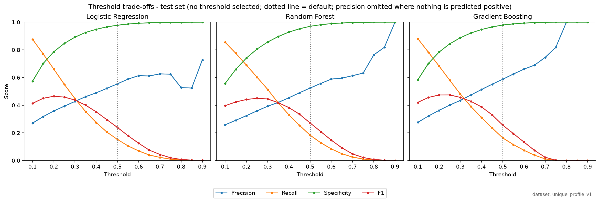

---

## 15. Calibration

A model is well calibrated when its predicted probabilities match observed frequencies (Van Calster et
al., 2019). Calibration was assessed with the Brier score (Brier, 1950), expected calibration error (ECE)
over 10 equal-width bins (Pakdaman Naeini et al., 2015) and calibration curves (Table 17, Figure 11).

Gradient boosting is the best calibrated model (Brier 0.1051, ECE 0.0074) and follows the diagonal up to
predicted probabilities of about 0.7. Logistic regression (Brier 0.1075, ECE 0.0117) is well calibrated
below 0.4 and slightly overestimates above it, for example predicting 0.64 on average in the 0.6–0.7 bin
where 0.61 is observed. The random forest (Brier 0.1104, ECE 0.0213) overestimates from about 0.4 upward,
predicting 0.73 in the 0.7–0.8 bin where 0.59 is observed. Such differences between model families are
expected, because each learning method distorts probabilities in its own way (Niculescu-Mizil & Caruana,
2005).

Two points qualify these summaries. About half of the test rows fall in the 0–0.1 bin, so the overall
scores mostly reflect the low-probability range, and bins with fewer than 50 rows are not interpreted.
Calibration is also distinct from discrimination: the rebalanced models in section 13 rank respondents
just as well but are poorly calibrated, with a Brier score of 0.184.

**Table 17.** Calibration summary (`unique_profile_v1`, test n = 45,895; 10 equal-width bins).

| Model | Brier score | Expected calibration error |
|---|---|---|
| Gradient boosting | 0.1051 | 0.0074 |
| Logistic regression | 0.1075 | 0.0117 |
| Random forest | 0.1104 | 0.0213 |

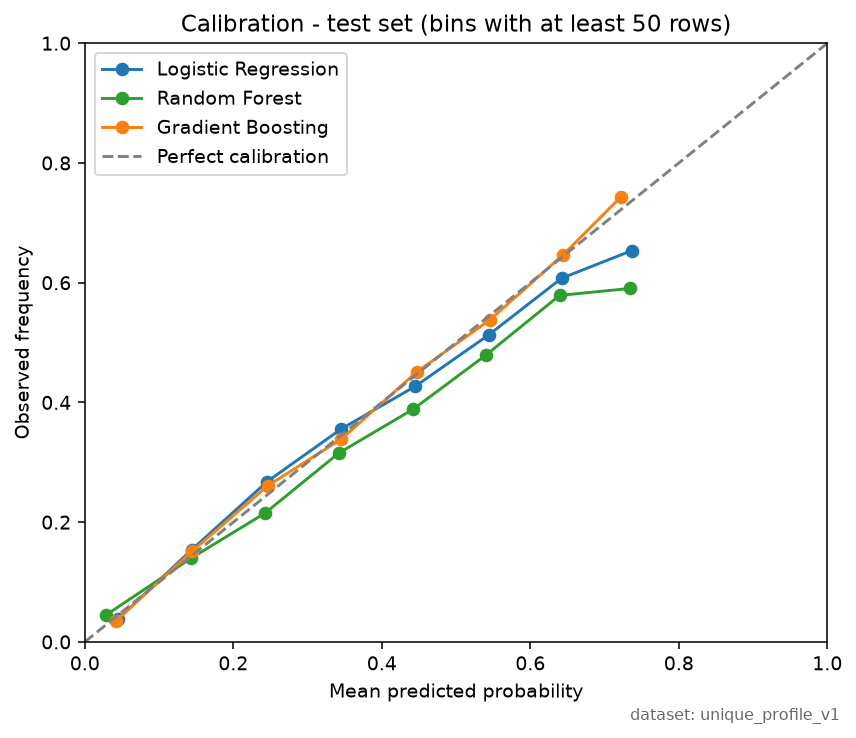

---

## 16. Model interpretation

Feature importance was measured by permutation: each feature was shuffled 10 times on 10,000 test rows,
and its importance is the mean drop in ROC AUC (Breiman, 2001). The three models agree closely (Table 18,
Figure 12). All share the same top five features, general health, BMI, high blood pressure, age and high
cholesterol, which are also among the strongest associations in the regression of section 10.

Importance and odds ratios measure different things. Having had a cholesterol check has the largest
adjusted odds ratio but low importance, because only 3.7% of respondents lack a check, so shuffling the
feature changes few predictions. Two further cautions apply. Correlated features such as general health,
physical-health days and difficulty walking share credit, so each can look less important than it would
alone (Strobl et al., 2008). And importance describes how useful a feature is to a particular model, not
whether it causes the outcome.

**Table 18.** Top five features by permutation importance, mean ROC AUC drop (`unique_profile_v1`,
10,000 test rows).

| Rank | Logistic regression | Random forest | Gradient boosting |
|---|---|---|---|
| 1 | GenHlth (0.060) | GenHlth (0.047) | GenHlth (0.052) |
| 2 | BMI (0.033) | BMI (0.041) | BMI (0.043) |
| 3 | HighBP (0.028) | Age (0.028) | Age (0.034) |
| 4 | Age (0.023) | HighBP (0.026) | HighBP (0.021) |
| 5 | HighChol (0.013) | HighChol (0.016) | HighChol (0.011) |

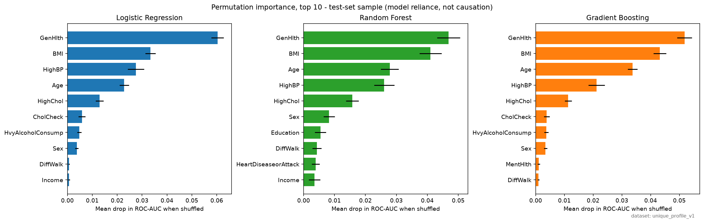

---

## 17. Limitations

The results should be read with the following limitations in mind.

1. **Derived dataset.** The UCI/Kaggle dataset is derived from BRFSS 2015; it is not the raw
   complex-survey analytical environment.
2. **No survey weights.** BRFSS sampling weights and design are not reproduced, so the results describe
   this sample, not the prevalence of either condition in the U.S. population.
3. **Combined outcome.** The positive class combines prediabetes and diabetes, which may relate
   differently to the indicators.
4. **No causal claims.** The data are cross-sectional and observational, so every relationship reported
   is an association.
5. **Duplicates.** 24,206 rows exactly repeat an earlier row, and without a respondent identifier their
   origin cannot be determined.
6. **Deduplication is a choice.** Removing repeats for machine learning is an analytical decision, not
   proof that repeats are errors.
7. **Predictive performance is not clinical utility.** A ROC AUC of up to 0.819 on this sample does not
   establish clinical usefulness or external validity.
8. **Thresholds depend on context.** The appropriate threshold depends on the costs of missed and false
   cases; none was chosen here.
9. **Calibration may not transfer.** Calibration and discrimination can change in other populations.
10. **Generalization.** The results should not be applied to current populations without validation.

Several further limitations are specific to individual analyses. Self-reported measures carry reporting
error, and extreme BMI values (up to 98) could not be verified. In the inference sections, p-values
underflow at this sample size, no multiplicity adjustment was applied, ANOVA and post-hoc tests were not
implemented (a team decision), and the intervals ignore the survey design. The regression treats ordinal
codes as linear on the log-odds scale, and the repeated rows in `full_clean_v1` can make its standard
errors too small. The machine-learning results come from a single split without confidence intervals,
with default settings, no tuning and no separate validation set, and the imbalance experiments cover
logistic regression only. Finally, the application's Prediction Explorer fills 13 of the 21 inputs with
the most common training values; its output is a model estimate, not a diagnosis.

---

## 18. Conclusion

This project combined descriptive statistics, probability, inference, regression and machine learning to
study a prediabetes-or-diabetes outcome in 253,680 BRFSS 2015 responses. The answers to the research
questions are summarized below.

- **Sample and outcome (RQ1–RQ2).** 13.93% of respondents are in category 1. The share rises steeply
  with worse general health and older age, falls with income and education, and is higher among
  respondents with cardiometabolic conditions.
- **Probability and Bayes (RQ3–RQ4).** The probability of category 1 rises from 0.139 overall to 0.245
  with high blood pressure and 0.297 with both high blood pressure and high cholesterol, and Bayes'
  theorem reproduces every directly counted conditional probability.
- **Confidence intervals (RQ5).** Intervals are narrow at this sample size; for example, the BMI
  difference between groups is 4.14 points (4.06–4.22).
- **Tests and effect sizes (RQ6–RQ7).** All of H1–H7 reject independence (p < 0.001), but the effects
  range from negligible for smoking (V = 0.06) to medium-to-large for BMI (d = 0.64), so effect sizes, not
  p-values, distinguish them.
- **Adjusted associations (RQ8).** Most features stay associated after adjustment, notably high blood
  pressure (OR 2.13), high cholesterol (1.78) and general health (1.71 per step); smoking does not.
- **Interaction (RQ9).** The BMI association strengthens with age on the odds scale, from 1.026 to 1.089
  per BMI point, with a modest gain in fit.
- **Model comparison (RQ10).** Gradient boosting leads narrowly (ROC AUC 0.819, PR AUC 0.441), with
  logistic regression close behind (0.810, 0.414).
- **Class imbalance (RQ11).** Rebalancing trades precision for recall (recall from 0.15 to 0.76) without
  improving ranking, and it worsens calibration.
- **Thresholds and calibration (RQ12).** F1 peaks at thresholds of 0.20–0.25, well below 0.5, and
  gradient boosting is the best calibrated model (ECE 0.007).
- **Duplicates (RQ13).** The grouped split leaves zero shared profiles between training and test data;
  keeping repeated rows raises ROC AUC by about 0.013 but lowers PR AUC.

Taken together, a small set of inexpensive survey indicators, led by general health, BMI, blood
pressure, age and cholesterol, is consistently associated with the outcome and supports moderate
discrimination, but the default decision rule misses most positive cases, and the choice of threshold
matters as much as the choice of model. Future work could add cross-validation or a validation set for
tuning and threshold selection, apply the BRFSS survey weights, and validate the models on another
survey year.

---

## 19. References

Akaike, H. (1974). A new look at the statistical model identification. *IEEE Transactions on Automatic
Control, 19*(6), 716–723. https://doi.org/10.1109/TAC.1974.1100705

Breiman, L. (2001). Random forests. *Machine Learning, 45*(1), 5–32.
https://doi.org/10.1023/A:1010933404324

Brier, G. W. (1950). Verification of forecasts expressed in terms of probability. *Monthly Weather
Review, 78*(1), 1–3. https://doi.org/10.1175/1520-0493(1950)078<0001:VOFEIT>2.0.CO;2

*CDC diabetes health indicators* [Data set]. (2017). UCI Machine Learning Repository.
https://doi.org/10.24432/C53919

Centers for Disease Control and Prevention. (2016a). *Behavioral Risk Factor Surveillance System survey
data 2015* [Data set]. U.S. Department of Health and Human Services.
https://www.cdc.gov/brfss/annual_data/annual_2015.html

Centers for Disease Control and Prevention. (2016b). *BRFSS 2015 codebook report*. U.S. Department of
Health and Human Services. https://www.cdc.gov/brfss/annual_data/2015/pdf/codebook15_llcp.pdf

Cohen, J. (1988). *Statistical power analysis for the behavioral sciences* (2nd ed.). Lawrence Erlbaum
Associates.

Cramér, H. (1946). *Mathematical methods of statistics*. Princeton University Press.

Fawcett, T. (2006). An introduction to ROC analysis. *Pattern Recognition Letters, 27*(8), 861–874.
https://doi.org/10.1016/j.patrec.2005.10.010

Friedman, J. H. (2001). Greedy function approximation: A gradient boosting machine. *The Annals of
Statistics, 29*(5), 1189–1232. https://doi.org/10.1214/aos/1013203451

Harris, C. R., Millman, K. J., van der Walt, S. J., Gommers, R., Virtanen, P., Cournapeau, D., Wieser,
E., Taylor, J., Berg, S., Smith, N. J., Kern, R., Picus, M., Hoyer, S., van Kerkwijk, M. H., Brett, M.,
Haldane, A., del Río, J. F., Wiebe, M., Peterson, P., . . . Oliphant, T. E. (2020). Array programming
with NumPy. *Nature, 585*(7825), 357–362. https://doi.org/10.1038/s41586-020-2649-2

He, H., & Garcia, E. A. (2009). Learning from imbalanced data. *IEEE Transactions on Knowledge and Data
Engineering, 21*(9), 1263–1284. https://doi.org/10.1109/TKDE.2008.239

Hosmer, D. W., Jr., Lemeshow, S., & Sturdivant, R. X. (2013). *Applied logistic regression* (3rd ed.).
Wiley. https://doi.org/10.1002/9781118548387

Hunter, J. D. (2007). Matplotlib: A 2D graphics environment. *Computing in Science & Engineering, 9*(3),
90–95. https://doi.org/10.1109/MCSE.2007.55

Kaufman, S., Rosset, S., Perlich, C., & Stitelman, O. (2012). Leakage in data mining: Formulation,
detection, and avoidance. *ACM Transactions on Knowledge Discovery from Data, 6*(4), 1–21.
https://doi.org/10.1145/2382577.2382579

McFadden, D. (1974). Conditional logit analysis of qualitative choice behavior. In P. Zarembka (Ed.),
*Frontiers in econometrics* (pp. 105–142). Academic Press.

McKinney, W. (2010). Data structures for statistical computing in Python. In S. van der Walt & J.
Millman (Eds.), *Proceedings of the 9th Python in Science Conference* (pp. 56–61).
https://doi.org/10.25080/Majora-92bf1922-00a

Niculescu-Mizil, A., & Caruana, R. (2005). Predicting good probabilities with supervised learning. In
*Proceedings of the 22nd International Conference on Machine Learning* (pp. 625–632). Association for
Computing Machinery. https://doi.org/10.1145/1102351.1102430

Pakdaman Naeini, M., Cooper, G. F., & Hauskrecht, M. (2015). Obtaining well calibrated probabilities
using Bayesian binning. *Proceedings of the AAAI Conference on Artificial Intelligence, 29*(1),
2901–2907. https://doi.org/10.1609/aaai.v29i1.9602

Pearson, K. (1900). On the criterion that a given system of deviations from the probable in the case of
a correlated system of variables is such that it can be reasonably supposed to have arisen from random
sampling. *The London, Edinburgh, and Dublin Philosophical Magazine and Journal of Science, 50*(302),
157–175. https://doi.org/10.1080/14786440009463897

Pedregosa, F., Varoquaux, G., Gramfort, A., Michel, V., Thirion, B., Grisel, O., Blondel, M.,
Prettenhofer, P., Weiss, R., Dubourg, V., Vanderplas, J., Passos, A., Cournapeau, D., Brucher, M.,
Perrot, M., & Duchesnay, É. (2011). Scikit-learn: Machine learning in Python. *Journal of Machine
Learning Research, 12*, 2825–2830. https://jmlr.org/papers/v12/pedregosa11a.html

Plotly Technologies Inc. (2015). *Collaborative data science*. https://plot.ly

Saito, T., & Rehmsmeier, M. (2015). The precision-recall plot is more informative than the ROC plot
when evaluating binary classifiers on imbalanced datasets. *PLOS ONE, 10*(3), Article e0118432.
https://doi.org/10.1371/journal.pone.0118432

Schwarz, G. (1978). Estimating the dimension of a model. *The Annals of Statistics, 6*(2), 461–464.
https://doi.org/10.1214/aos/1176344136

Seabold, S., & Perktold, J. (2010). Statsmodels: Econometric and statistical modeling with Python. In S.
van der Walt & J. Millman (Eds.), *Proceedings of the 9th Python in Science Conference* (pp. 92–96).
https://doi.org/10.25080/Majora-92bf1922-011

Snowflake Inc. (n.d.). *Streamlit* (Version 1.64.0) [Computer software]. https://streamlit.io

Spearman, C. (1904). The proof and measurement of association between two things. *The American Journal
of Psychology, 15*(1), 72–101. https://doi.org/10.2307/1412159

Steyerberg, E. W., Vickers, A. J., Cook, N. R., Gerds, T., Gonen, M., Obuchowski, N., Pencina, M. J., &
Kattan, M. W. (2010). Assessing the performance of prediction models: A framework for traditional and
novel measures. *Epidemiology, 21*(1), 128–138. https://doi.org/10.1097/EDE.0b013e3181c30fb2

Strobl, C., Boulesteix, A.-L., Kneib, T., Augustin, T., & Zeileis, A. (2008). Conditional variable
importance for random forests. *BMC Bioinformatics, 9*, Article 307.
https://doi.org/10.1186/1471-2105-9-307

Teboul, A. (2021). *Diabetes health indicators dataset* [Data set]. Kaggle.
https://www.kaggle.com/datasets/alexteboul/diabetes-health-indicators-dataset

Van Calster, B., McLernon, D. J., van Smeden, M., Wynants, L., & Steyerberg, E. W. (2019). Calibration:
The Achilles heel of predictive analytics. *BMC Medicine, 17*, Article 230.
https://doi.org/10.1186/s12916-019-1466-7

Virtanen, P., Gommers, R., Oliphant, T. E., Haberland, M., Reddy, T., Cournapeau, D., Burovski, E.,
Peterson, P., Weckesser, W., Bright, J., van der Walt, S. J., Brett, M., Wilson, J., Millman, K. J.,
Mayorov, N., Nelson, A. R. J., Jones, E., Kern, R., Larson, E., . . . SciPy 1.0 Contributors. (2020).
SciPy 1.0: Fundamental algorithms for scientific computing in Python. *Nature Methods, 17*(3), 261–272.
https://doi.org/10.1038/s41592-019-0686-2

Welch, B. L. (1947). The generalization of "Student's" problem when several different population
variances are involved. *Biometrika, 34*(1–2), 28–35. https://doi.org/10.1093/biomet/34.1-2.28

Wilks, S. S. (1938). The large-sample distribution of the likelihood ratio for testing composite
hypotheses. *The Annals of Mathematical Statistics, 9*(1), 60–62. https://doi.org/10.1214/aoms/1177732360

Wilson, E. B. (1927). Probable inference, the law of succession, and statistical inference. *Journal of
the American Statistical Association, 22*(158), 209–212. https://doi.org/10.1080/01621459.1927.10502953

Xie, Z., Nikolayeva, O., Luo, J., & Li, D. (2019). Building risk prediction models for type 2 diabetes
using machine learning techniques. *Preventing Chronic Disease, 16*, Article 190109.
https://doi.org/10.5888/pcd16.190109

---

## Appendix A. Reproducibility

All results can be regenerated from the repository with four commands:

```text
python -m pip install -r requirements.txt
python -m src.analysis.pipeline --csv data/raw/cdc_diabetes.csv
python -m pytest tests/ -q
streamlit run streamlit_app.py
```

The pipeline downloads the verified UCI dataset if it is missing, then runs the EDA, statistics,
regression, modeling and duplicate-sensitivity exports in about 2.5 minutes. The results in this report
were produced from the file with SHA-256 fingerprint
`0f8ff13c40c0908fc6e9bf43dc05b3be706c6195481ac595b8e0adb256a79774`, which is recorded in the regression,
modeling and duplicate-sensitivity manifests. The EDA manifest (`outputs/eda_manifest.json`) records a
different fingerprint, `4b702ecd…a6f60`, because the EDA was first exported from a differently formatted
copy of the same data; both copies pass every reference check, and re-running the EDA export on the
`0f8ff13c…` file reproduces every EDA table exactly.

A full re-run reproduced 153 of the 154 exported tables exactly. In `duplicate_sensitivity.csv`, ROC AUC
and PR AUC differ by at most 0.00001 because of multithreaded training. The results were produced with
Python 3.14, scikit-learn 1.9.1 (Pedregosa et al., 2011), statsmodels 0.15.0 (Seabold & Perktold, 2010),
pandas 3.0 (McKinney, 2010), NumPy 2.5 (Harris et al., 2020), SciPy 1.18 (Virtanen et al., 2020),
Matplotlib 3.11 (Hunter, 2007), Streamlit 1.64 (Snowflake Inc., n.d.) and Plotly 7.1 (Plotly Technologies
Inc., 2015). The code is covered by 548 automated tests that run on synthetic data. The commit described
by this report is [FINAL COMMIT HASH].

---

## Appendix B. Streamlit application

The interactive application is available at
https://diabeteshealthanalytics-arunava-binish-sanjay.streamlit.app. Its eleven pages are grouped into
Data, Statistics and Modeling sections, and every page names the dataset variant it uses. All
statistics are computed by the same analysis code as this report; the pages only display them.

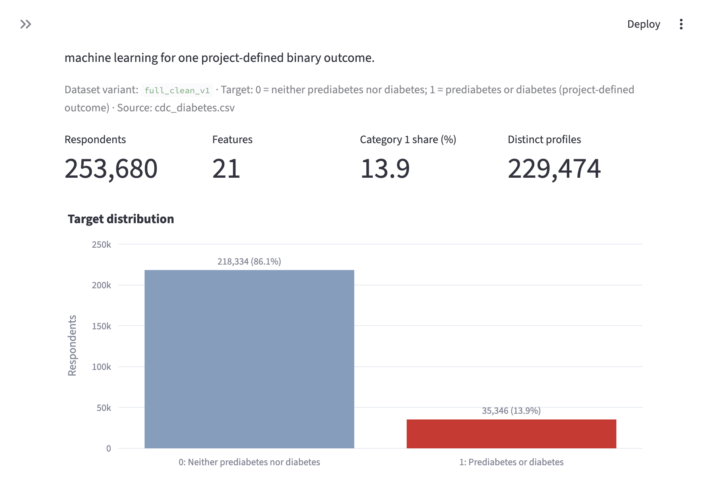

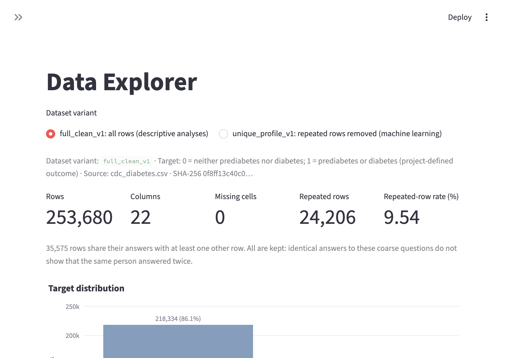

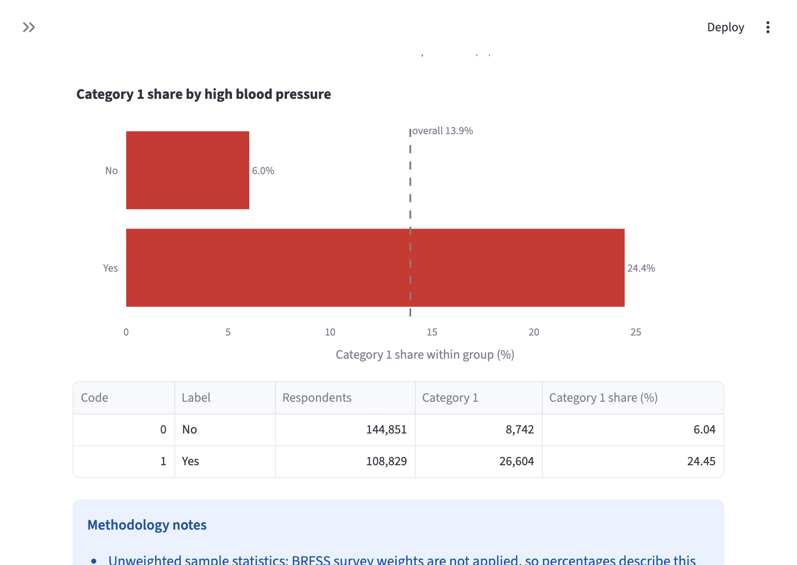

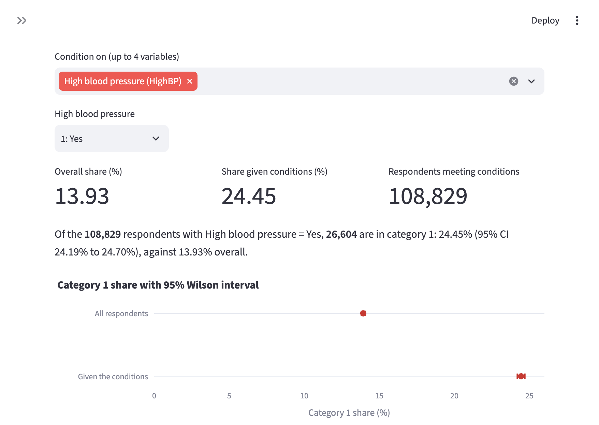

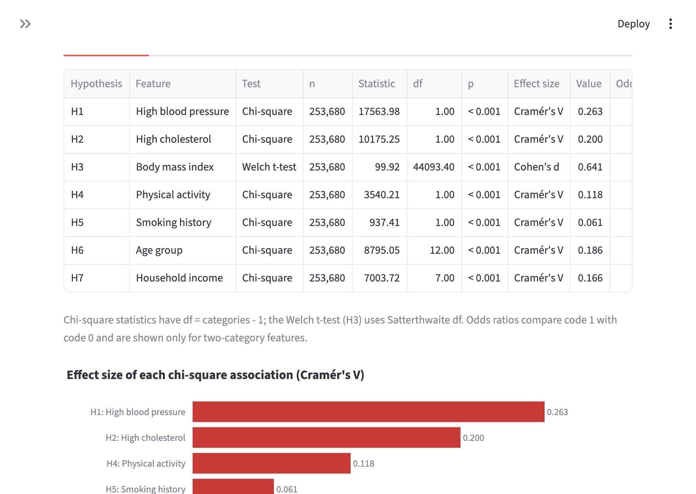

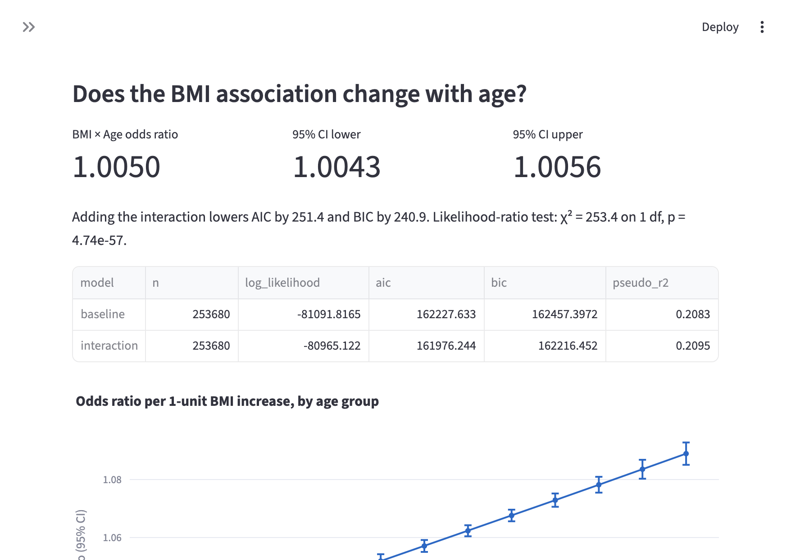

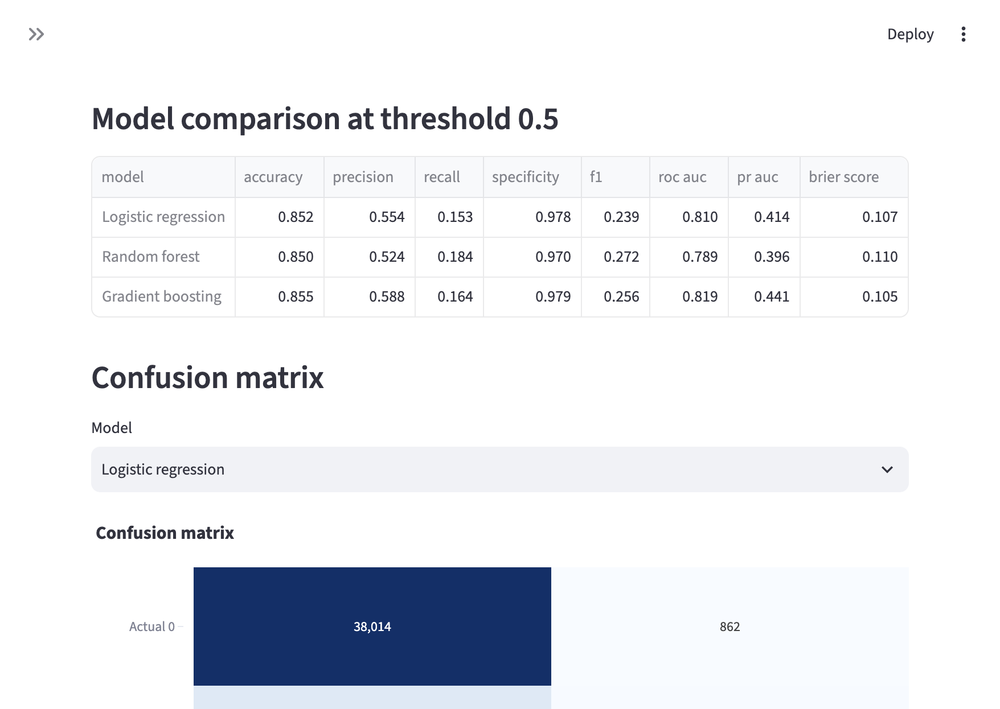

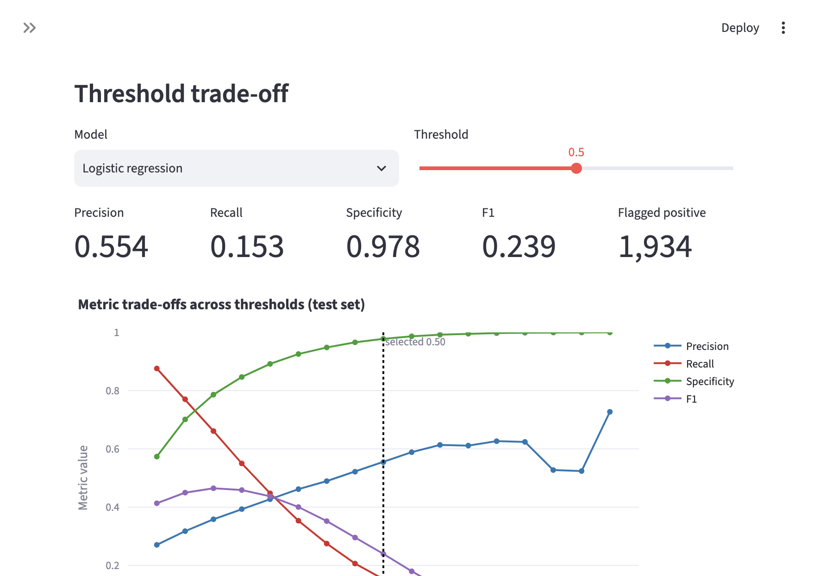

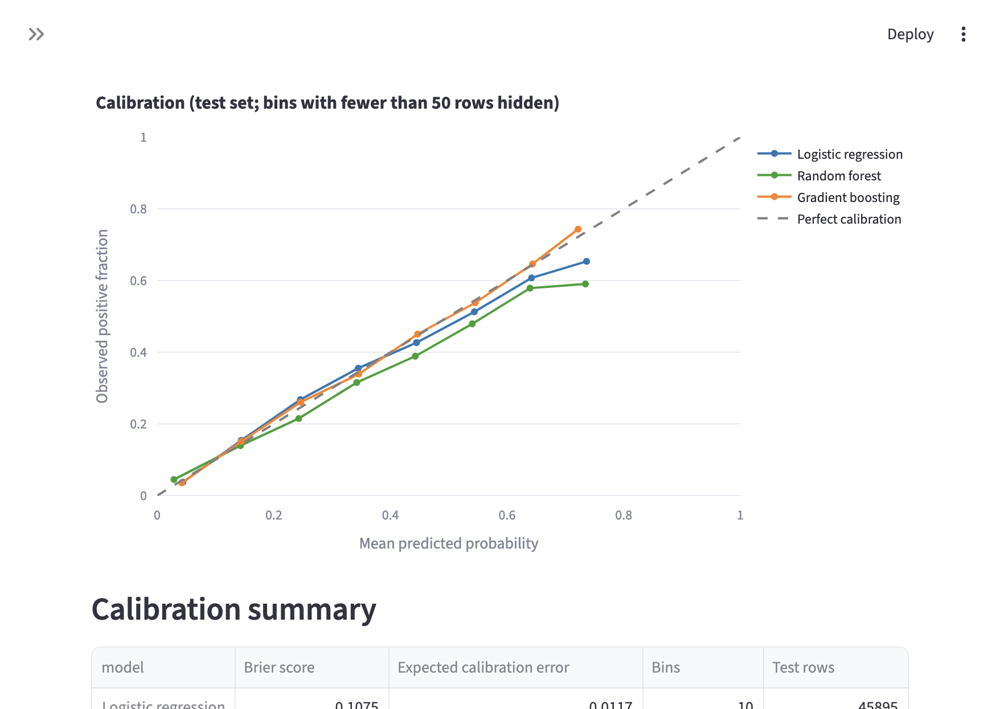

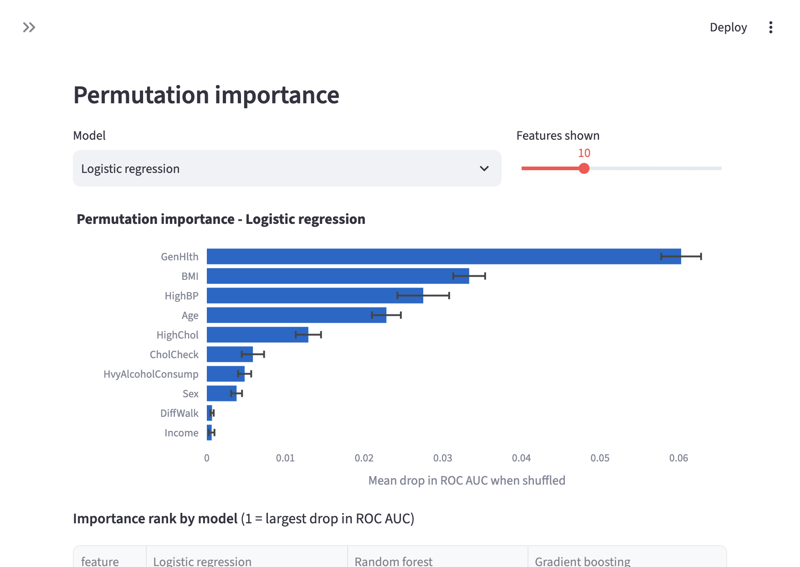

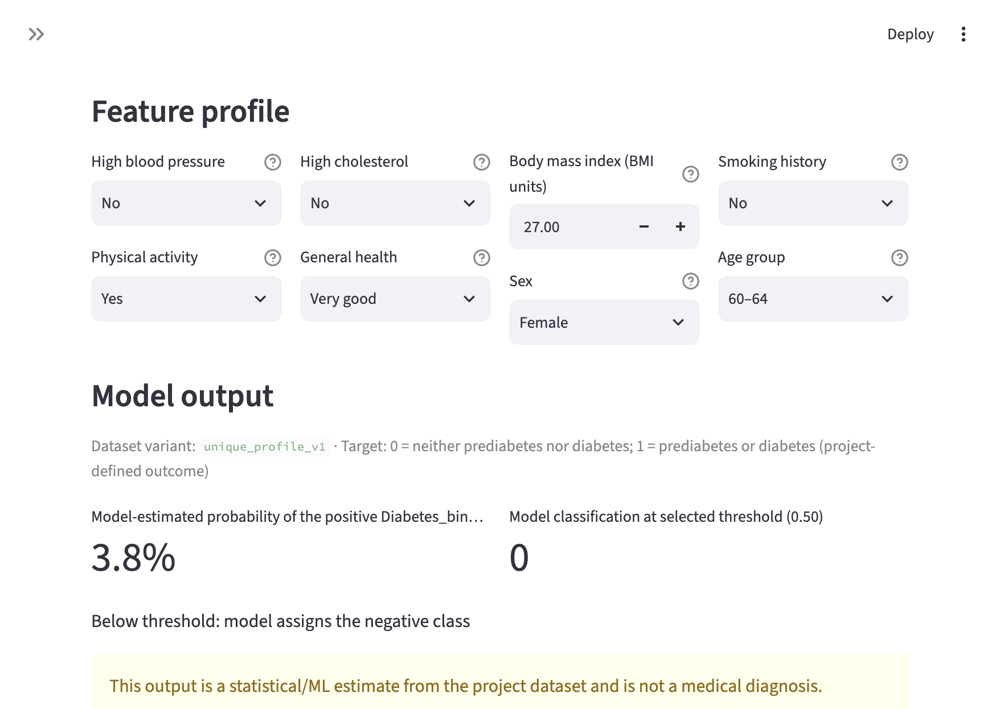

---

## Appendix C. Traceability

Every value reported above can be traced to a file produced by the analysis pipeline.

| Reported value | Section | Source file | Column / key |
|---|---|---|---|
| 253,680 rows, 22 columns, 0 missing | 2 | `outputs/tables/full_clean_v1_data_quality.json` | `rows`, `columns`, `missing_cells` |
| Reference checks pass | 2 | `outputs/eda_manifest.json` | `reference_checks` |
| 24,206 repeated rows (9.54%); 229,474 profiles; 35,575 rows in repeated patterns | 4 | `outputs/tables/full_clean_v1_data_quality.json` | `duplicate_rows`, `duplicate_rate_percent`, `distinct_patterns`, `rows_in_repeated_patterns` |
| Category 1 share 13.93% / 15.29%; removed rows 23,957 category 0 and 249 category 1 (difference of the two files) | 4, 5 | `outputs/tables/{full_clean_v1,unique_profile_v1}_target_distribution.csv` | `count`, `percentage` |
| Largest full-vs-unique shifts | 4 | `outputs/tables/full_vs_unique_sensitivity.csv` | `change_unique_minus_full` |
| 9,847 BMI IQR flags (fences 13.5 and 41.5) | 4 | `outputs/tables/full_clean_v1_data_quality.json` | `potential_outliers.BMI.flagged_count`, `lower_boundary`, `upper_boundary` |
| 0 shared profiles; 183,579 / 45,895 rows | 4, 12 | `outputs/modeling_manifest.json` | `leakage_check`, `train_rows`, `test_rows` |
| Duplicate scenarios (Tables 4–5) | 4 | `outputs/tables/duplicate_sensitivity.csv` | `scenario`, `roc_auc`, `pr_auc`, `brier_score`, row counts (`test_subset` = `all`) |
| BMI and health-day summaries | 5 | `outputs/tables/full_clean_v1_numeric_summary.csv`, `full_clean_v1_health_days_by_target.csv` | `mean`, `std`, `q1`, `q3`; `*_mean`, `*_30_percent` |
| Category 1 share by group (Table 6) | 5 | `outputs/tables/full_clean_v1_prevalence_*.csv` | `total_observations`, `target_percentage` |
| Binary indicator gaps | 5 | `outputs/tables/full_clean_v1_binary_comparisons.csv` | `category_1_percent_yes/no`, `difference_percentage_points` |
| Spearman ρ with the outcome | 5 | `outputs/tables/full_clean_v1_spearman_correlation.csv` | column `Diabetes_binary` |
| Marginal, joint, conditional probabilities (Table 7) | 6 | `outputs/tables/member2_probability_results.csv` | `p_conditions`, `p_conditions_and_category1`, `p_category1_given_conditions`, `ci_lower`, `ci_upper` |
| Bayes check and lift (Table 8) | 6 | `outputs/tables/member2_bayes_results.csv` | `likelihood_p_feature_given_category1`, `evidence_p_feature`, `bayes_rhs`, `direct_p_category1_given_feature`, `lift_over_prior` |
| Confidence intervals (Table 9) | 7 | `outputs/tables/member2_confidence_intervals.csv` | `estimate`, `ci_lower`, `ci_upper`, `method` |
| H1–H7 statistics, effect sizes, unadjusted ORs (Tables 10–11) | 8, 9 | `outputs/tables/member2_hypothesis_results.csv` | `statistic`, `dof`, `p_value`, `effect_value`, `odds_ratio`, `or_lower`, `or_upper` |
| BMI skewness 1.53 / 2.33 | 8 | `outputs/tables/member2_hypothesis_results.csv` | `warnings` (H3) |
| Adjusted ORs (Table 12) | 10 | `outputs/tables/full_clean_v1_regression_baseline_odds_ratios.csv` | `odds_ratio`, `ci_lower`, `ci_upper`, `p_value` |
| Centering means, convergence | 10 | `outputs/regression_manifest.json` | `centering_means`, `converged` |
| Model comparison, LR test (Table 13) | 11 | `outputs/tables/full_clean_v1_regression_model_comparison.csv`, `outputs/regression_manifest.json` | `log_likelihood`, `aic`, `bic`, `pseudo_r2`; `model_comparison`, `interaction_term` |
| BMI OR by age | 11 | `outputs/tables/full_clean_v1_regression_bmi_odds_by_age.csv` | `bmi_odds_ratio`, `ci_lower`, `ci_upper` |
| Classifier metrics (Table 14) | 12 | `outputs/tables/model_comparison.csv` | metric columns |
| Imbalance strategies (Table 15) | 13 | `outputs/tables/imbalance_experiments.csv` | metric columns, `train_*_after` |
| Threshold trade-offs (Table 16), F1 peaks, threshold 0.15 | 13, 14 | `outputs/tables/thresholds_analysis_*.csv` | `threshold`, `recall`, `precision`, `f1` |
| Brier, ECE (Table 17) | 15 | `outputs/models/metrics.json` | `test_metrics.<model>.brier_score`, `calibration.<model>.expected_calibration_error` |
| Calibration bins | 15 | `outputs/tables/calibration_table_*.csv` | `mean_predicted`, `observed_frequency`, `count` |
| Permutation importance (Table 18) | 16 | `outputs/tables/feature_importance_*.csv` | `importance_mean` |
| Dataset SHA-256 | A | `outputs/regression_manifest.json`, `outputs/modeling_manifest.json` | `dataset_version_sha256` |
